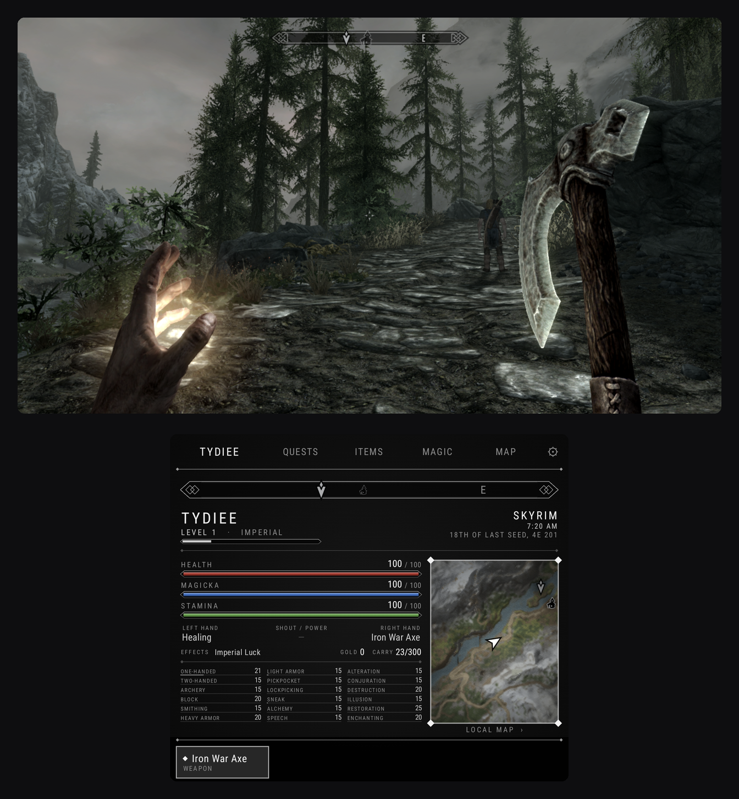
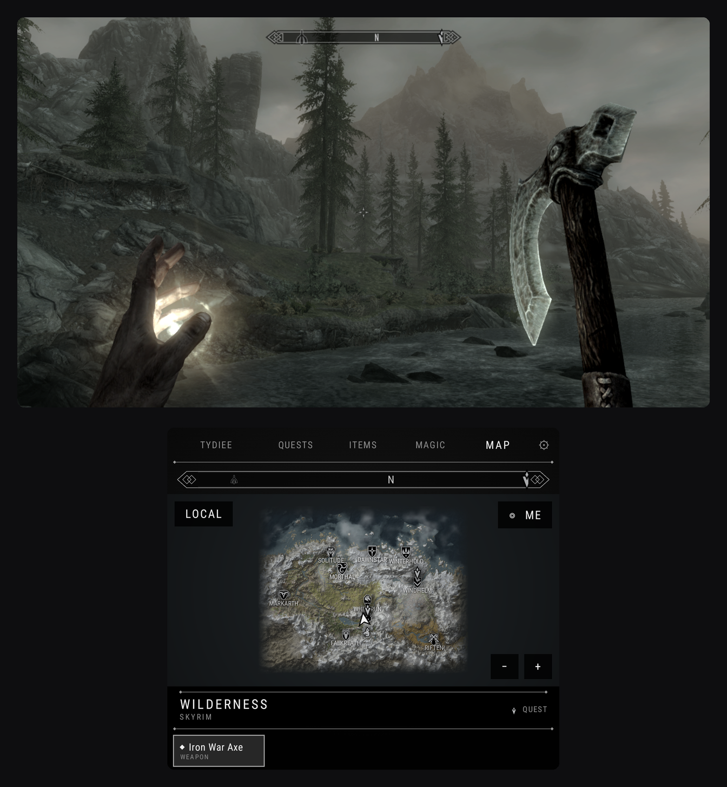
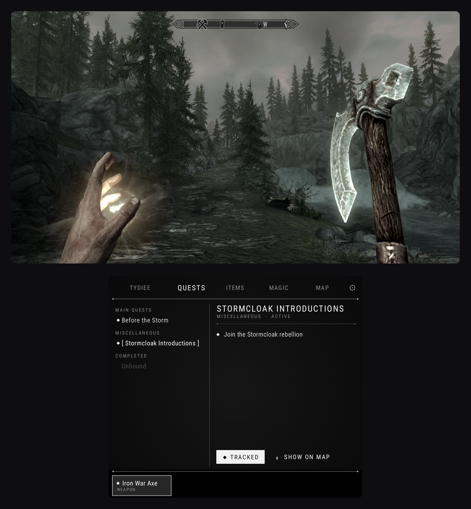
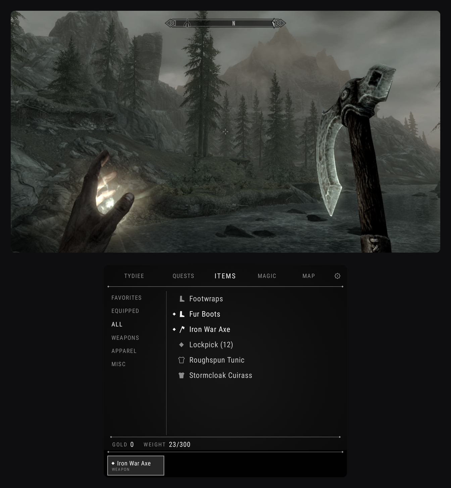
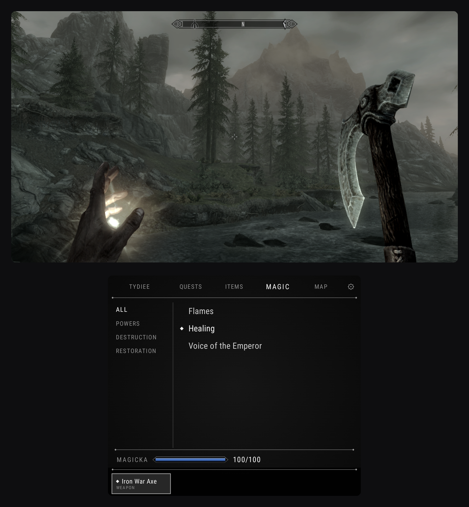

# SkyrimSE-DualScreen

The Steam copy of **The Elder Scrolls V: Skyrim Special Edition** you already own, on the **AYN Thor**, as one app:

- **Top screen:** Skyrim, plus a launcher and an in-app Nexus Mods browser.
- **Bottom screen:** a companion styled like the game's own menus:
  - character, quests (with tracking), items and magic (left or right hand);
  - a live map with fast travel, a minimap, and the game's compass with its own icons;
  - a favourites quick bar;
  - Quicksave, Wait, and Save and Quit, one tap away in ⚙.
  - The game keeps running while you use the menus. You can turn on pausing in ⚙ if you want menus to work like the game's own.
  - The keyboard opens down here too (naming your character, searching Nexus), so it never covers the game.
- **Mods:** sign in to Nexus Mods, then browse, download and install inside the app. Requirements are offered and the load order is sorted for you. A **Recommended for the Thor** list installs 30 tested mods in one go.
- **One app on both screens:** Back, Home and launchers like **Cocoon** treat Skyrim as a single game, so pausing and resuming from your launcher just works.
- **12 languages:** English, Chinese (Simplified and Traditional), Japanese, Korean, Spanish, Portuguese (Brazil), French, German, Italian, Russian and Polish.

  
  

  
  
  

Nothing from Skyrim is included. The game files, the map and the icons all come from your own copy.

## What you need

- An **AYN Thor**.
- **Skyrim Special Edition** on your **Steam** account (version 1.7.104, the current Steam build).
- Optional: a **Nexus Mods** account (free is fine) if you want mods.

## Install

1. On your PC, find `Steam/steamapps/common/Skyrim Special Edition` and copy the whole folder to the Thor, for example to `Internal storage/SkyrimSE-DualScreen/Skyrim Special Edition`.

   **Copy a clean Skyrim folder.** Mods already in the folder from your PC will load, but they skip the faster boot and the Mod Manager can't remove them. Install mods inside the app instead, and remove any ENB or ReShade files (`d3d11.dll`, `dxgi.dll`).
2. Download the latest `SkyrimSE-DualScreen-x.y.z.apk` from **Releases** and install it.
3. Open the app (pick your language at the top right) and follow the three steps:
   1. allow file access;
   2. choose the `Skyrim Special Edition` folder;
   3. sign in to Steam.
4. Press **Play**. The bottom-screen companion works straight away; nothing else to install.

The first time, the app downloads its game engine (needs Wi-Fi and about 3 GB free) in the background while you do the steps above. The very first Play then sets up Wine for Skyrim, which takes a minute or two; later launches reach the menu in under a minute, and the loading screen shows each step. Expect a little stutter for the first few minutes of play while the shader cache fills.

After you've signed in to Steam once, you can also play offline. The app checks for new releases itself and offers them on the launcher; install updates over the old app, never uninstall first.

## Tips

- **Power** in the launcher: **Max** (60 FPS, the default), **Balanced** (40 FPS, smooth on the 120 Hz screen and noticeably cooler) or **Cool** (30 FPS, coolest and longest battery).
- **FPS limit** (launcher, or ⚙ in game): ‹ › steps through the rates that run smoothly on your screen (on the Thor: 20, 24, 30, 40, 60, 120 or Unlimited). Choose **Custom** for a slider with any value from 20 to 120.
- **Graphics › Thor** (default) is Skyrim's Low preset tuned for the Thor:
  - **on:** blood and impact decals, no rain under roofs, snow sparkles, lens flare, and smoother fade-in of distant objects and people;
  - **off:** the effects that cost the most for the least, namely ambient occlusion, god-rays, reflections, big shadow maps and TAA;
  - **no depth-of-field blur**, so distant scenery stays sharp. (Skyrim needs its depth-of-field setting on for quicksaves and autosaves to work, so the app keeps it on and removes the blur itself.)
- **Performance stats:** turn on in the launcher or the bottom screen's ⚙ to see FPS, CPU/GPU load and temperatures on the game screen. Values are white and turn red as they get worse.
- **Overheat protection** (Launcher › Advanced, on by default): if the Thor stays above 95°C, Skyrim saves ("Overheat Save") and closes so it can cool down.
- **Frame generation:** copy `Lossless.dll` from your own Lossless Scaling (Steam, on your PC) to the Thor, then add it in Launcher › Performance › Lossless Scaling DLL and set Frame Gen to 2X. Expect about 90 FPS on screen from about 45 real frames, with a little extra input delay.
- **Sleep:** press the power button any time. Skyrim freezes (no CPU use, no heat) and carries on when you wake the Thor.
- **Game HUD:** hide the game's compass or health bars from the bottom screen's ⚙ if you'd rather use the companion.
- **Dim with game light** (⚙, on by default): the bottom screen darkens in dark places so it doesn't glare at night or in dungeons.
- **Back:** in game, Back opens the companion's ⚙; press it twice quickly to leave the game (both screens) and come back to it later exactly where you were. **Quit App** in the bottom launcher closes everything.
- **Something wrong?** **Report a Problem** (launcher or ⚙) saves a log bundle to `Download/` and opens a pre-filled GitHub issue to attach it to. Passwords and sign-ins are stripped from the logs.
- **Mods:** Skyrim's own menu only lists Creations. Your mods are in the launcher's Mod Manager, and in ⚙ › "Mods loaded by the game".

## What's inside

- **Windows runtime** from [GameNative](https://github.com/utkarshdalal/GameNative): Wine/Proton, FEX/Box64, DXVK and Turnip.
- **Native Steam:** no Windows Steam runs, and saves sync with Steam Cloud.
- **`SkyrimAYN.dll`:** shares live game state with the bottom screen ([source](native/)).
- **Mod manager:** Nexus Mods API, FOMOD installers, requirements, safe uninstall with backups, automatic load order, and shareable mod lists.

**SKSE (Script Extender):** many popular mods need it, SkyUI for example. When you install a mod that needs SKSE, the mod manager tells you and installs it for you. The app and the bottom-screen companion work with or without it.

**Lighting mods:** lighting overhauls may stop Skyrim from starting. ELFX and Lightened Skyrim have been reported to hang at boot.

**Where mods go:** installed mods live in the app's own storage, where Skyrim reads them much faster (28 mods: about 45 seconds to the menu instead of nearly 4 minutes). Your Skyrim folder stays plain Skyrim. Mods installed by 1.0.2 or earlier are moved there automatically the first time 1.0.3 opens, before you can press Play. The mod list and the downloaded archives stay in `SkyrimAYN/` inside your Skyrim folder, so if you ever uninstall the app, your mods are unpacked again from those archives without downloading. To update, install the new APK over the old one; don't uninstall first.

## Tested on the Thor

- About 57–60 FPS in the open world with the default settings (Power › Max, Graphics › Thor, 720p), including with the 30-mod Recommended list. Short dips while saving are normal.
- 30 mods: about 45 seconds from Play to the main menu.
- Steam Cloud saves, offline play after the first sign-in, quicksave and autosave.
- Cocoon: launching, pausing (double Back) and resuming Skyrim on dual screen.
- Sleep with the power button mid-game, then carrying on.

## Building

`./gradlew :app:assembleModernRelease-signed` needs your own keystore in `app/keystores/keystore.properties`. The plugin and loader are built from `native/` (see `native/README.md`) and copied into `app/src/main/assets/skyrimayn/skse/`.

## Licence and credits

- This app is a fork of GameNative and, like GameNative, licensed under **GPL-3.0**. See `LICENSE` and `THIRD_PARTY_NOTICES`. The original GameNative readme is in `docs/GAMENATIVE_README.md`.
- **Skyrim** is © Bethesda Softworks. This project is not affiliated with or endorsed by Bethesda, ZeniMax, Valve, Nexus Mods or AYN.
