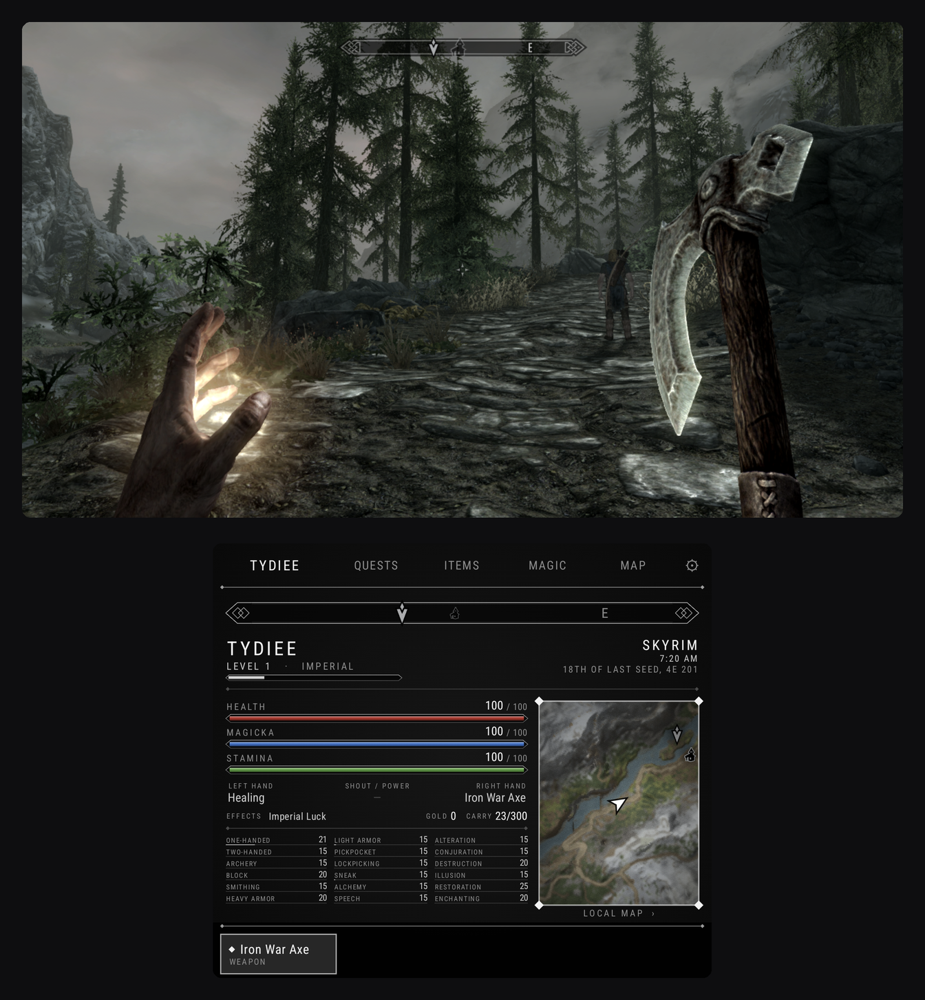
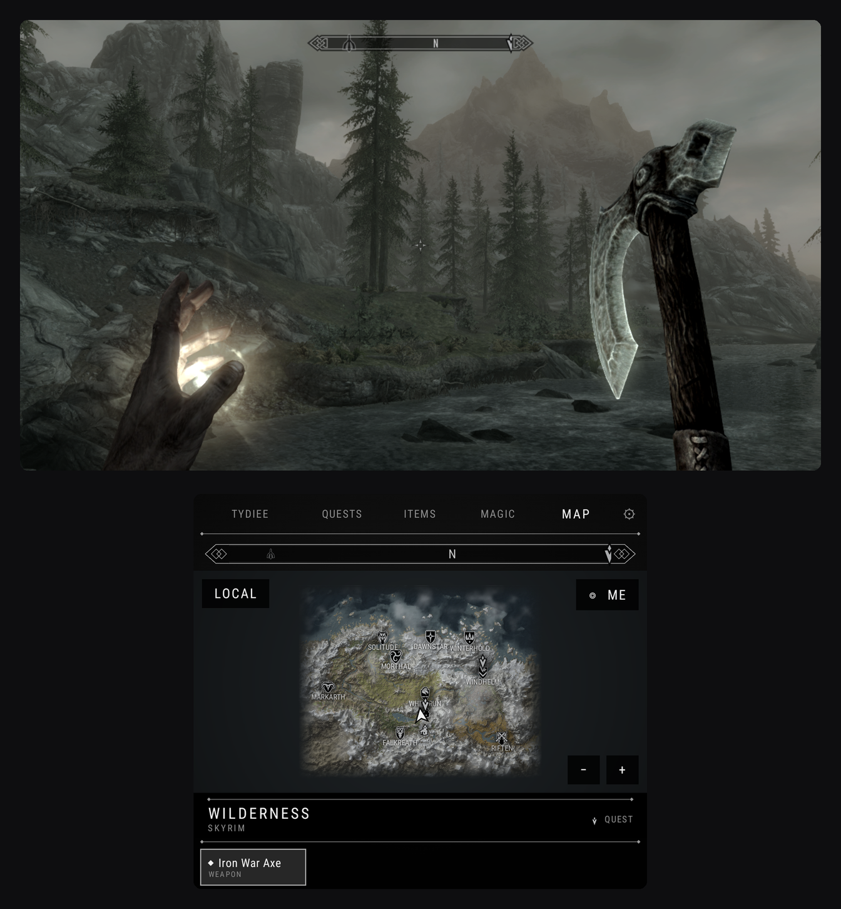

**Skyrim Special Edition on the AYN Thor, with a second screen built for it.**

Your own Steam copy of Skyrim runs on the top screen. The bottom screen is a live companion styled like the game's own menus: your character, the compass, quests, items, magic, the map and a favourites bar, always one tap away.

No Skyrim files are included. You play the copy you own, with Steam Cloud saves.

  
  

## What's in 1.0.0

### Bottom-screen companion
| | |
|---|---|
| **Character** | Health, magicka and stamina, equipped hands and shout, active effects, gold, carry weight, all 18 skills, and a live minimap |
| **Compass** | Mirrors the game's own every frame: the same markers, icons and fades |
| **Quests** | Every objective, with **Track** and **Show on map** |
| **Items & Magic** | Laid out like the game's menus. Equip to either hand, and use potions and food |
| **Map** | Drawn from your game's own terrain and icons, with quest markers and fast travel |
| **Favourites bar** | One tap to equip |

- **The game keeps running** while you use the companion. If you'd rather it paused, turn that on in ⚙.
- **Nothing extra to install:** no Script Extender, no mods. If you add SKSE for mods later, the companion works with it too.
- **The game's HUD can go:** hide Skyrim's compass or health bars from ⚙ and use the bottom screen instead.

### Launcher
- **Play**, with your latest save shown underneath.
- **Power:** Max (60 FPS, the default), Balanced (45 FPS) or Cool (30 FPS).
- **Graphics › Thor** (the default): Skyrim's Low preset with the cheap details turned back on (decals, snow sparkles, lens flare, smoother fade-in) and the expensive ones off. It holds 55–60 FPS at 720p.
- **Performance overlay:** just FPS, or FPS plus CPU/GPU load and temperatures. Values turn red as they climb.
- **Overheat protection:** if the Thor stays above 95°C, Skyrim saves ("Overheat Save") and closes so the Thor can cool down.
- **Sleep any time:** Skyrim freezes completely and picks up where you left off when you wake the Thor.
- **Frame generation (optional):** uses `Lossless.dll` from your own copy of Lossless Scaling, for about 90 FPS on screen.
- **Updates:** the app checks for new versions and installs them for you.

### Mods
- Sign in to **Nexus Mods** inside the app, then browse, download and install.
- Requirements are offered first, FOMOD installers work, and the load order is sorted for you.
- Your saves are backed up before any mod is installed or removed, and removing a mod puts back the files it replaced.

## What you need
- An **AYN Thor**.
- **Skyrim Special Edition on Steam**, version **1.7.104** (the current Steam version).
- About **3 GB free** space and **Wi-Fi** for the first setup.
- A PC to copy the game folder from, once.

## Install
1. On your PC, copy the folder `Steam/steamapps/common/Skyrim Special Edition` to the Thor, for example into `Internal storage/SkyrimSE-DualScreen/`.
2. Download **`SkyrimSE-DualScreen-1.0.0.apk`** from the assets below and install it.
3. Open the app and follow the three setup steps:
   1. allow file access;
   2. choose your Skyrim folder;
   3. sign in to Steam.
4. Press **Play**. The first time, accept Skyrim's EULA when it appears.

> **The first launch takes a few minutes, once.** The app sets up Windows for Skyrim and builds shaders for the Thor's GPU. The loading screen shows which step it's on. After that, Skyrim reaches its menu in under a minute. Expect a little stutter in your first few minutes of play while the shader cache fills.

Your saves sync with Steam Cloud. After your first sign-in you can play offline too.

## Known limits
- Only **Skyrim SE 1.7.104 on Steam**. The GOG version and downgraded versions aren't supported. Anniversary Edition content works.
- Frame generation adds a little input delay. If Skyrim fails to start with it on, the app switches it off by itself.
- Mods, especially graphics mods, cost frames and heat. The 60 FPS target is for the unmodded game.

## Found a bug?
[Open an issue](https://github.com/plus-cloud/SkyrimSE-DualScreen/issues/new?template=bug_report.md). Say what you were doing and what you expected, and attach a screenshot if you can.

## Credits
- Built on [GameNative](https://github.com/utkarshdalal/GameNative), which supplies Wine/Proton, FEX, DXVK and Turnip. Licensed under **GPL-3.0**.
- Skyrim is © Bethesda Softworks. This project isn't affiliated with or endorsed by Bethesda, ZeniMax, Valve, Nexus Mods or AYN.

---
**SHA-256** (`SkyrimSE-DualScreen-1.0.0.apk`): `4201c9bcb5c885fca25e06b04ee88d9144ced0ed59ef92f66cf4e36e30d8a57b`
